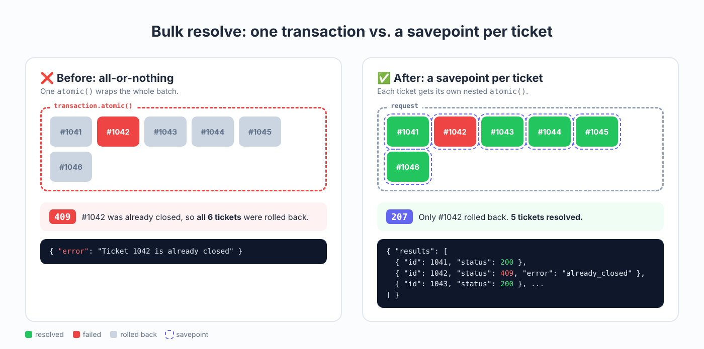

On ETEPS, our field service platform, support agents often need to close dozens of tickets at once. The first version of our bulk-resolve endpoint did the obvious thing: wrap the whole batch in one transaction and loop.

It worked until it didn't. One ticket in a batch of fifty was already closed by someone else, the service raised, and the whole transaction rolled back. The agent saw a single error message and had no idea that the other forty-nine tickets were fine and just needed a retry.

Here's how I fixed it.

<figure>
  
  <figcaption>Left: one failed ticket rolls back the whole batch. Right: each ticket has its own savepoint, so only the failed one rolls back.</figcaption>
</figure>

## The problem with all-or-nothing

A single `transaction.atomic()` around the loop gives you all-or-nothing semantics. That's the right call when the items depend on each other, like the lines of one invoice. Resolving fifty unrelated tickets is not that. Each ticket is its own unit of work, so each one should succeed or fail on its own.

## Savepoint per item

Django turns a nested `atomic()` block into a database savepoint. If the block raises, only that savepoint is rolled back. So the fix is to give every ticket its own `atomic()` block and catch errors *outside* it:

```python
from django.db import transaction

def bulk_resolve(ticket_ids, user):
    results = []
    for ticket_id in ticket_ids:
        try:
            with transaction.atomic():  # one savepoint per ticket
                ticket = Ticket.objects.select_for_update().get(pk=ticket_id)
                resolve_ticket(ticket, user)  # service layer, raises domain errors
            results.append({"id": ticket_id, "status": 200})
        except Ticket.DoesNotExist:
            results.append({"id": ticket_id, "status": 404, "error": "not_found"})
        except TicketAlreadyClosed:
            results.append({"id": ticket_id, "status": 409, "error": "already_closed"})
        except TicketNotResolvable as exc:
            results.append({"id": ticket_id, "status": 422, "error": str(exc)})
    return results
```

Two details matter here:

- **Catch outside the block, not inside.** If you catch a database error inside `atomic()`, Django can't tell the block failed, and the connection is left in a broken state for the next ticket. Let the exception leave the block so the savepoint rolls back cleanly.
- **Named domain exceptions.** `resolve_ticket` raises `TicketAlreadyClosed` or `TicketNotResolvable` instead of a generic `ValueError`. That's what makes it easy to map each failure to a meaningful status code.

## Telling the client what happened: 207 Multi-Status

Once each ticket has its own outcome, a single HTTP status code can't describe the response. `200` hides the failures, and `400` hides the successes.

`207 Multi-Status` exists for exactly this case: the response body carries a status for each item.

```python
from rest_framework.response import Response
from rest_framework.views import APIView

class BulkResolveView(APIView):
    def post(self, request):
        serializer = BulkResolveSerializer(data=request.data)
        serializer.is_valid(raise_exception=True)

        results = bulk_resolve(serializer.validated_data["ticket_ids"], request.user)

        all_ok = all(r["status"] == 200 for r in results)
        return Response({"results": results}, status=200 if all_ok else 207)
```

The client gets something like this:

```json
{
  "results": [
    {"id": 1041, "status": 200},
    {"id": 1042, "status": 409, "error": "already_closed"},
    {"id": 1043, "status": 200}
  ]
}
```

Now the frontend can mark the successes as done and show the agent exactly which tickets need attention.

## Takeaways

- Ask whether a batch is really one unit of work. Often it isn't.
- In Django, a nested `atomic()` block is a savepoint. Use one per independent item.
- Let exceptions leave the `atomic()` block, then catch them.
- Return `207` with a status per item when the outcomes differ.
