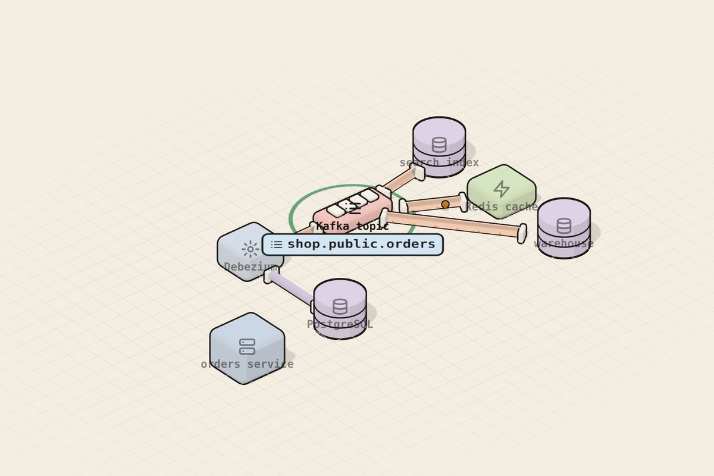

When I revise system design, boxes and arrows on a whiteboard only get me halfway. The interesting part is what happens over time: a retry storm building up, a worker pool filling with stuck calls, a circuit breaker opening and closing again. A static diagram can't show any of that.

So I built [Backend Atlas](https://0mustafa37.github.io/learningdesgin/): over 100 walkthroughs, from caching and sharding to incident response and disaster recovery, where every system runs as a small animated 3D model you can rotate and scrub through.

<figure>
  
  <figcaption>The change data capture lesson: one stream from the database's log feeds search, a cache and a warehouse.</figcaption>
</figure>

## Lessons are data, not drawings

I didn't want to hand-animate 100 scenes. Each lesson is a small JavaScript object: units with a kind and a position, and steps that list which flows happen.

```js
L({
  id: "timeouts-retries",
  nodes: [N("client", "client", 90, 230, "client"),
          N("a", "checkout service", 360, 220, "server"),
          N("b", "payment API", 650, 210, "ext")],
  steps: [
    { s: "Hang", h: "The payment API hangs",
      f: "client>a:req, a>b:fail", a: "a b" },
    // ...
  ],
});
```

The engine does the rest. A `db` becomes a cylinder, a `queue` a long block with message slots, a `client` a laptop. Every flow becomes a pipe, and packets roll through it in order. Steps can add or remove units, which animate in and out, so a lesson can grow the architecture as the story goes on.

The same events feed a trace panel under the scene (`checkout → payment  POST /v1/charges`). I added it because, as a developer, I trust a log line more than an animation.

## The look: toon shading and inverted-hull outlines

I wanted a flat, illustrated style instead of shiny 3D. Two tricks do most of the work:

- **Toon shading.** `MeshToonMaterial` with a three-step gradient gives each face one flat tone: light top, mid side, darker side.
- **Inverted-hull outlines.** Each mesh gets a slightly bigger copy of itself, drawn in ink colour with only its back faces rendered. From the camera, only the rim of that copy shows, which reads as a thick outline.

```js
const rbox = (w, h, d, r, mat, parent) => {
  const m = new THREE.Mesh(new RoundedBoxGeometry(w, h, d, 4, r), mat);
  m.add(new THREE.Mesh(
    new RoundedBoxGeometry(w + OUT * 2, h + OUT * 2, d + OUT * 2, 4, r + OUT),
    new THREE.MeshBasicMaterial({ color: INK, side: THREE.BackSide })));
  parent.add(m);
  return m;
};
```

An orthographic camera keeps the isometric feel. Instead of a fixed zoom, it fits the frame to the units each lesson actually has, so a three-unit lesson and a seven-unit one both fill the stage. On narrow phone screens it tries a few angles and picks the one that fills the frame best.

## Richer scenes when a lesson needs them

Most lessons only need flows. Some need instruments: a worker pool filling up, a timeout countdown, a breaker state. For those, a step can include an `fx(t, S)` function that the engine calls every frame with the loop clock:

```js
fx(t, S) {
  const busy = Math.min(8, stuckCallsAt(t));
  S.pool("a", Array.from({ length: 8 }, (_, i) => (i < busy ? "stuck" : "idle")));
  S.metric("cpu", "Workers busy", `${busy} / 8`, busy === 8 ? "bad" : "warn");
  S.tag("b", `no reply · ${(t / 1000).toFixed(1)} s`, "bad", "hourglass");
}
```

Steps can also carry a setup table and a code snippet for the side panel. The Django and Python examples are the parts I'd actually say in an interview.

## No build step, on purpose

The site is plain files on GitHub Pages: an HTML page, a few scripts, and three.js copied into a `vendor/` folder. No bundler, no framework. The engine is an ES module, which has one cost: you have to serve the folder over HTTP instead of opening `index.html` from disk.

Without a build step there are also no content hashes in file names. The first deploy that added new lessons showed a blank page to anyone whose browser had cached the old course list next to the new lesson file. The fix was a version query on every script URL (`app.js?v=20261126`) and making the router ignore lessons that aren't in the course list. Now I bump the version on every release.

## Testing it without a GPU

Every change runs through a headless Chrome script (Playwright with SwiftShader for WebGL) that opens every step of every lesson and fails on any console error. It also takes screenshots, which caught most of my layout mistakes: labels hidden behind units, tags cut off at the edge, a camera that was too far away.

## Takeaways

- If you have a lot of similar visuals, make them data-driven early.
- Toon shading plus inverted-hull outlines gives a clean illustrated look for very little code.
- Without a build step, you're responsible for cache busting.
- Test visual software the way you test an API: automatically, on every route.

The source is on [GitHub](https://github.com/0Mustafa37/learningdesgin), and the site has a [practice mode](https://0mustafa37.github.io/learningdesgin/#/practice) if you want to test yourself.
